# Manual de usuario — AndesCafé

> Capturas tomadas en un celular Android real. Donde dice `[Captura]` falta agregar la captura de esa pantalla.

## 1. Funciones para todos los roles
### 1.1 Crear cuenta
1. En el login toca **¿No tienes cuenta? Regístrate**.
2. Escribe nombre, correo y contraseña (mínimo 6 caracteres), confírmala y elige **Comprador** o **Vendedor**.
3. Toca **Crear cuenta**.
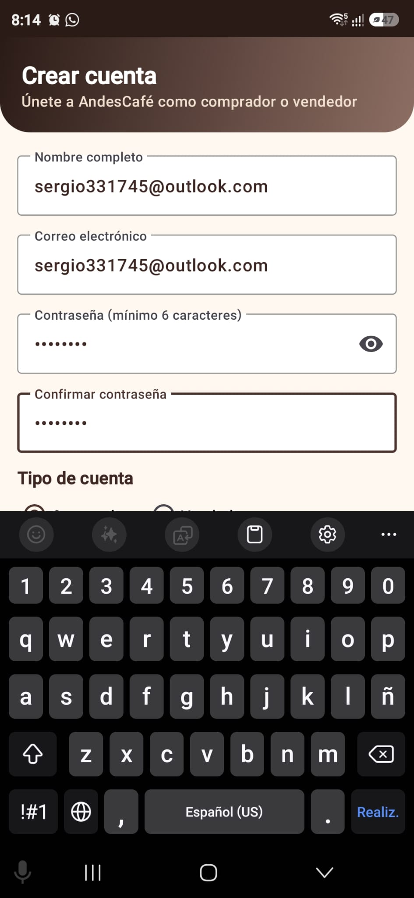{width=5.5cm}

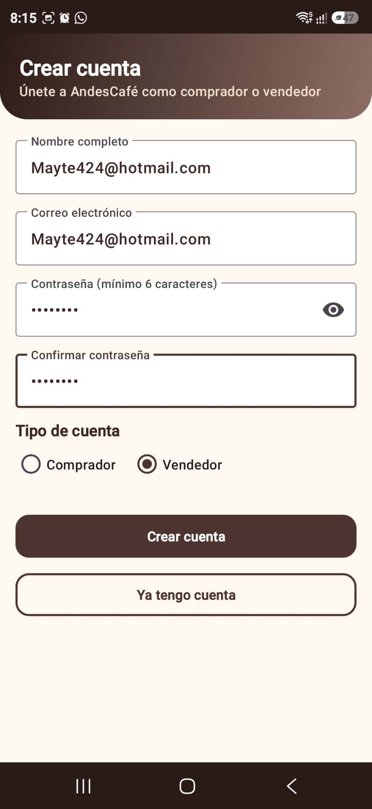{width=5.5cm}

*Figura: formulario de registro (comprador y vendedor).*
> Los administradores los crea otro administrador.

### 1.2 Iniciar sesión
Escribe correo y contraseña, deja marcada **Habilitar huella en este dispositivo** (opcional) y toca **Iniciar sesión**.
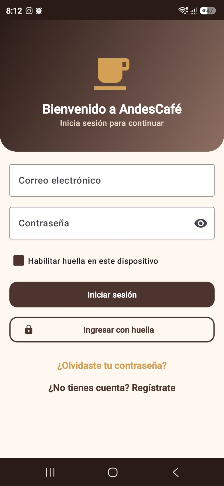{width=5.5cm}

### 1.3 Ingresar con huella
Toca **Ingresar con huella** y apoya el dedo en el sensor. Requiere haber iniciado sesión antes con la casilla marcada. `[Captura]`

### 1.4 Recuperar contraseña
Toca **¿Olvidaste tu contraseña?**, escribe tu correo y **Enviar enlace**. Revisa tu correo y sigue el enlace.
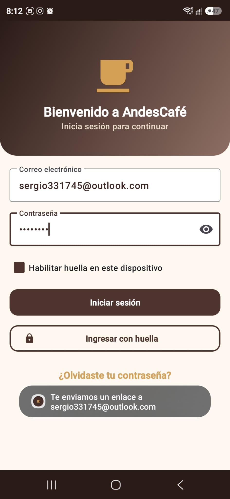{width=5.5cm}

*Figura: aviso de que se envió el enlace de recuperación.*

### 1.5 Cerrar sesión
Administrador y Vendedor: menú lateral → **Cerrar sesión**. Comprador: pestaña **Perfil** → **Cerrar sesión**. `[Captura]`

## 2. Administrador
Navega con el **menú lateral** (☰).
- **Dashboard:** totales de usuarios, productos, pedidos y ventas. `[Captura]`
- **Usuarios:** lista en tiempo real.
  - *Crear:* botón **+** → nombre, correo, contraseña temporal, rol → **Guardar usuario**. `[Captura]`
  - *Editar:* toca un usuario → cambia nombre, rol o activa/desactiva la cuenta. `[Captura]`
  - *Eliminar:* mantén presionado → confirma. `[Captura]`
- **Productos:** ve todos los productos; mantén presionado para eliminar. `[Captura]`
- **Reporte de ventas:** total acumulado y lista de pedidos; **Compartir reporte** lo envía por la app que elijas. `[Captura]`

## 3. Vendedor
Menú lateral del vendedor:
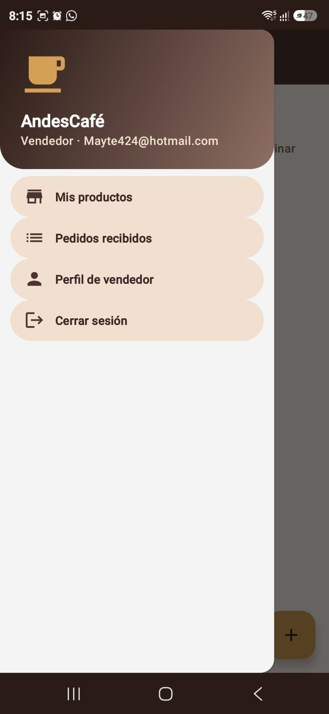{width=5.5cm}

- **Mis productos:** lista de tus productos.
  - *Crear:* **+** → foto con **Tomar foto** o **Galería**, nombre, descripción, precio, existencias → **Guardar producto**.
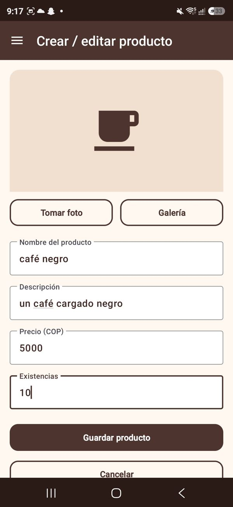{width=5.2cm}

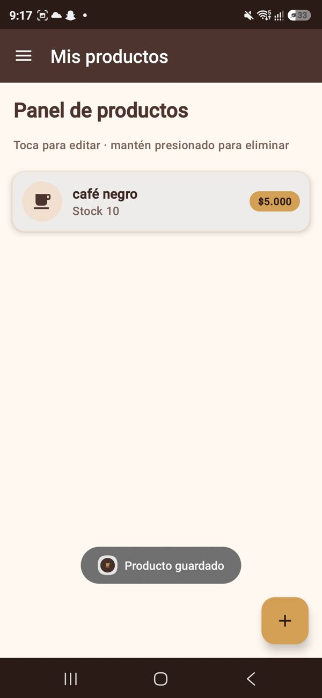{width=5.2cm}

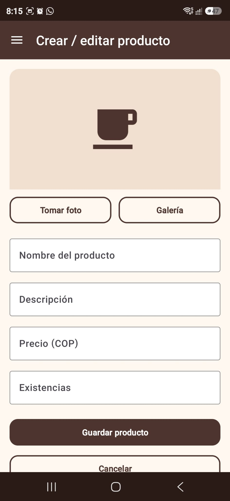{width=5.5cm}

  - *Editar:* toca el producto. *Eliminar:* mantén presionado. `[Captura]`
- **Pedidos recibidos:** toca un pedido para ver la **dirección en Google Maps**; mantén presionado para cambiar el estado (Pagado, Enviado, Entregado). `[Captura]`
- **Perfil:** edita nombre, teléfono y dirección → **Guardar cambios**. `[Captura]`

## 4. Comprador (menú inferior)
- **Inicio:** saludo y productos disponibles.
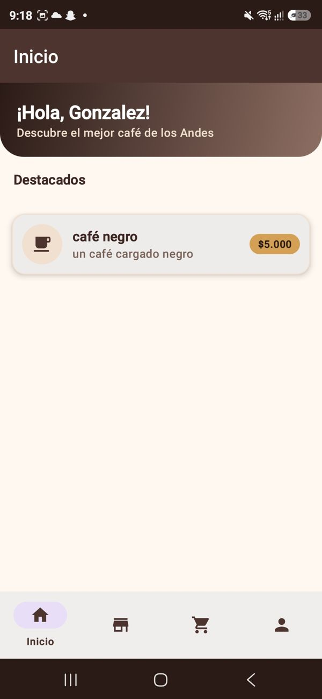{width=5.2cm}

- **Catálogo:** cuadrícula con buscador; toca un producto. `[Captura]`
- **Detalle:** imagen, precio y existencias; elige cantidad con − / + y **Agregar al carrito**.
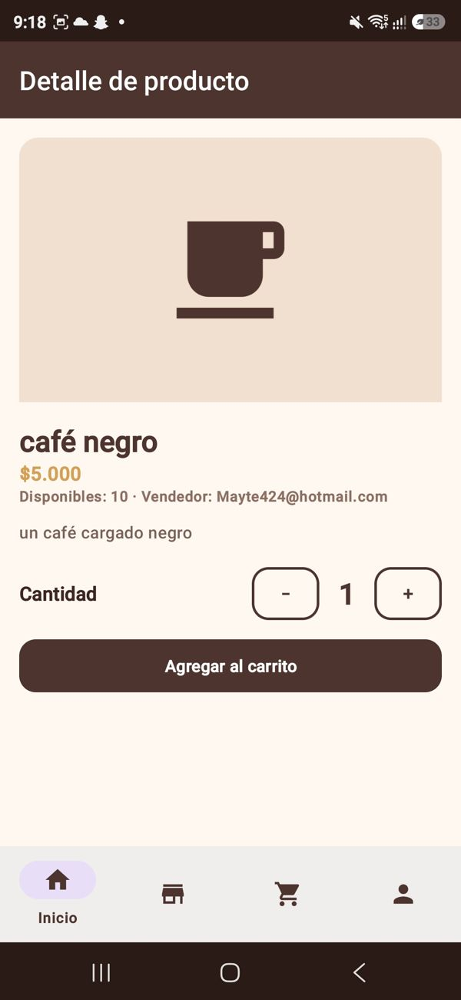{width=5.2cm}

- **Carrito:** toca un ítem para aumentar, disminuir o eliminar; ve el total; **Ir a pagar**.
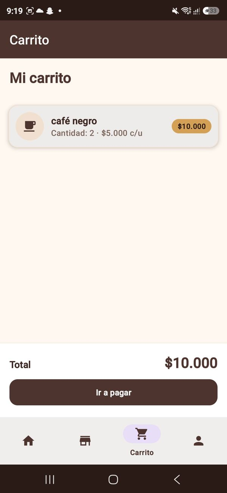{width=5.2cm}

- **Pago:**
  1. Escribe la dirección o toca **Usar mi ubicación actual** (acepta el permiso y activa el GPS).
  2. Toca **Pagar**, confirma el pago (simulado en esta versión) y espera la confirmación.
  3. Al aprobarse verás **Mis pedidos** con tu compra.
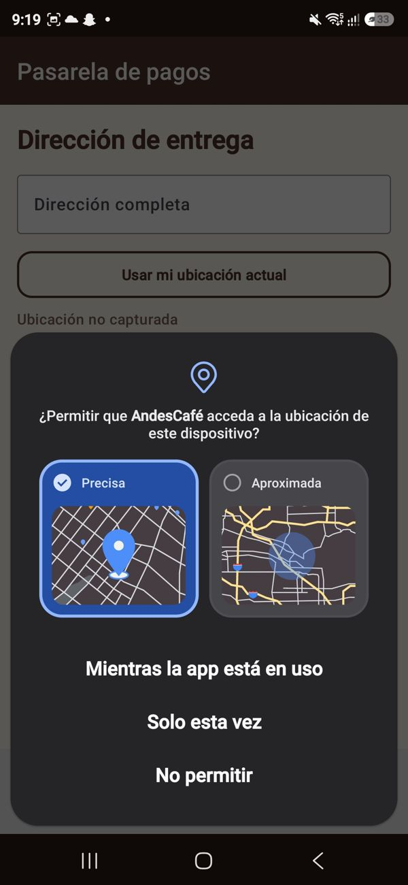{width=5.2cm}

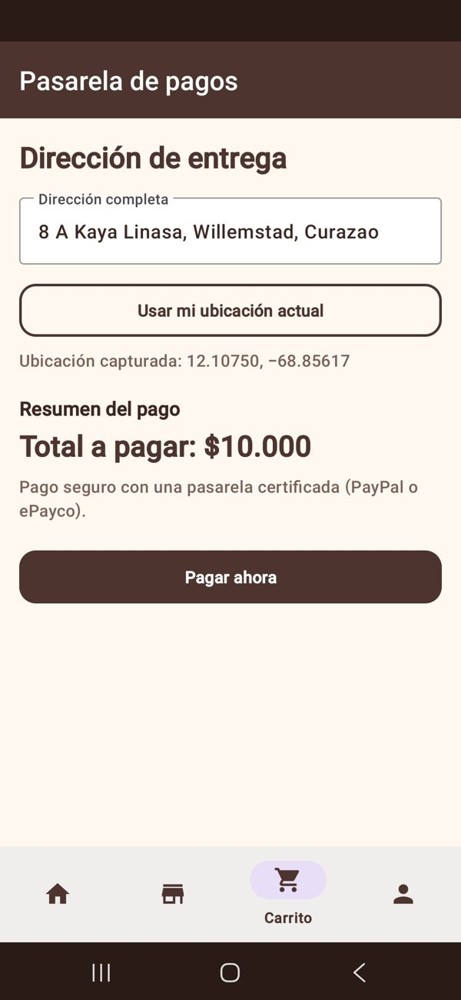{width=5.2cm}

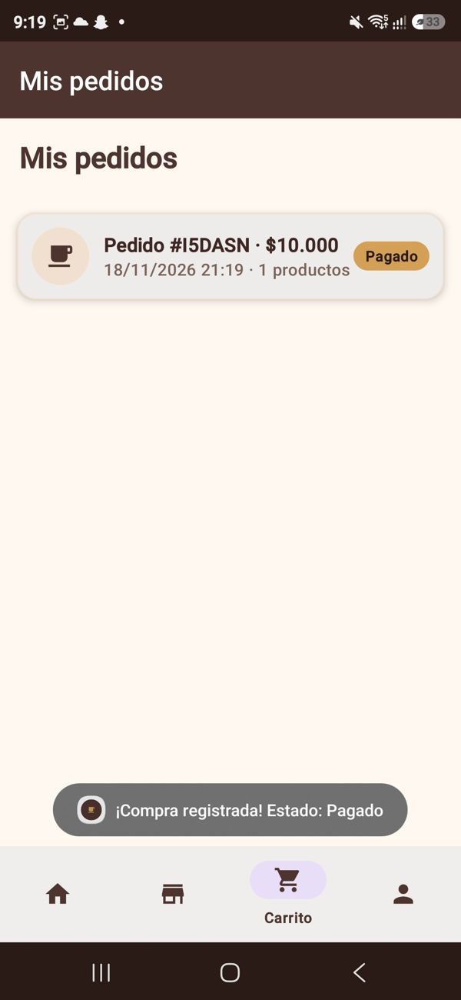{width=5.2cm}

- **Perfil:** edita tus datos, abre **Mis pedidos** (historial) o cierra sesión.
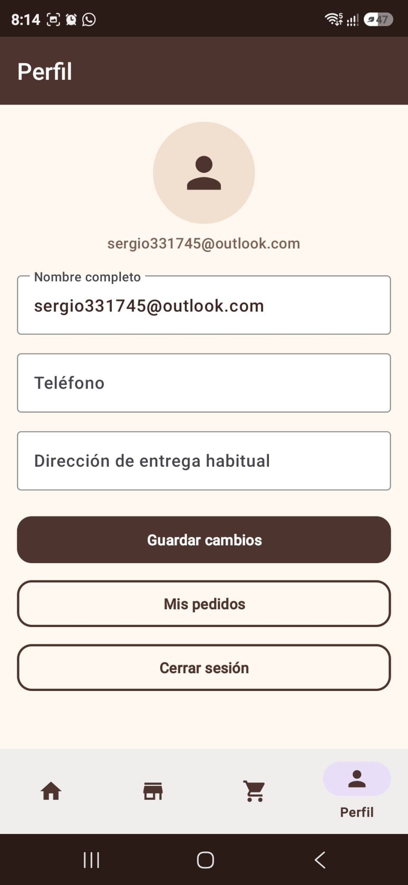{width=5.5cm}

## 5. Problemas frecuentes
| Problema | Solución |
|---|---|
| "Tu cuenta no está habilitada" | El administrador debe activarla o crearla. |
| La huella no funciona | Registra una huella en el celular y vuelve a iniciar sesión con la casilla marcada. |
| No obtiene la ubicación | Activa el GPS y acepta el permiso. |
| El pago no se confirma | Revisa tu conexión y vuelve a intentarlo desde el carrito. |
